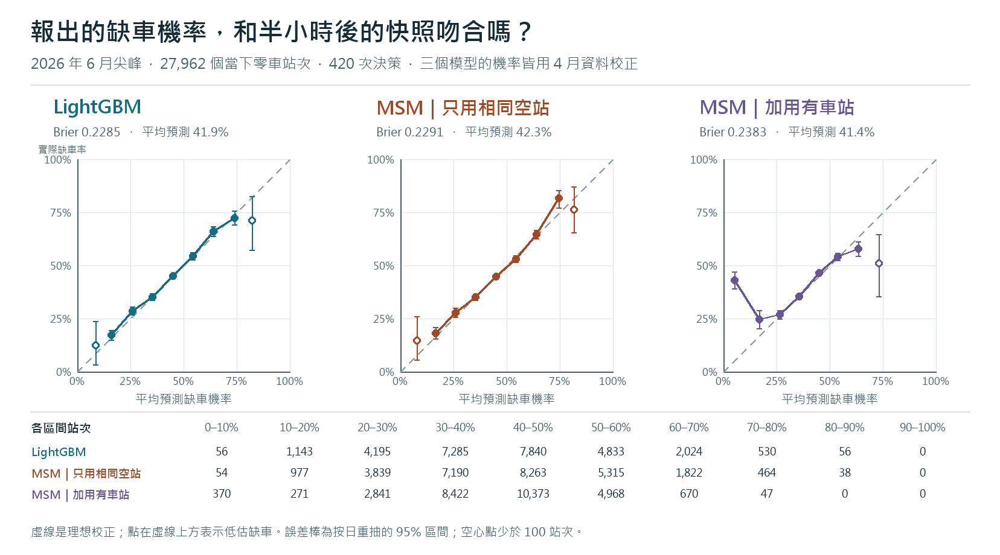

# 六月尖峰空站排序：68 特徵 MSM 對照 LightGBM

**我們在做什麼？** 預警頁面已經知道哪些站現在沒有車。這個實驗問的是：**假設每半小時只能先處理 3 站或 10 站，哪個模型比較能挑中「下一張快照還是零車」的站？** 這是離線預測評估，不改產品門檻、派車演算法或線上模型，也不是與官方調度紀錄的比較。

## 六月答案

| 模型（同樣 68 個輸入特徵） | Top 3 命中／入選 | Top 10 命中／入選 | Brier，低較好 |
|---|---:|---:|---:|
| 正式版 LightGBM | 870 / 1,260（69.05%） | 2,574 / 4,152（61.99%） | **0.22852** |
| **MSM：完全相同的訓練空站次** | **932 / 1,260（73.97%）** | **2,594 / 4,152（62.48%）** | 0.22912 |
| MSM：另加同期間有車站估雙向轉移 | 732 / 1,260（58.10%） | 2,306 / 4,152（55.54%） | 0.23827 |

前兩列才是相同訓練站次的主比較。MSM 的 Top 3 多命中 **62 站次，+4.92 個百分點**；兩模型按日配對重抽的 95% 區間是 **+1.19 到 +8.49**。Top 10 只多 20 次（+0.48 個百分點，區間 −0.72 至 +1.63）；Brier 差 +0.00060（區間 −0.00052 至 +0.00169）。後兩項的區間均含 0。這不等於兩模型永遠一樣，也不是跨月份成效保證。

**那 62 次從哪來？** 兩模型共同選了 617 個 Top 3 站次，其中 453 次命中。剩下各自獨選的 643 個站次，MSM 命中 479，LightGBM 命中 417。差距來自選了不同的站，而不是多發警示；這項統計還不能告訴我們是哪個特徵造成差距。

## 機率可信嗎？



例如在各模型自己報 70–80% 的站次中，LightGBM 平均報 73.7%、實際缺車 72.5%（530 站次）；相同空站訓練的 MSM 平均報 74.4%、實際 81.7%（464 站次）。所以 MSM 可以比較會選前三名，卻低估它自己認定的部分高風險站。Brier 是所有合格站次的平方誤差，不只看前三名，也不只衡量校正。

## 如何做到同條件比較？

- **問題與切分固定：**2026 年 1–3 月全天訓練，兩個主模型用同樣 225,086 個空站次；4/1–4/14 尖峰用同一批 13,992 筆各自做 Platt 校正。五月未參與本次擬合或選擇；六月僅回溯評估，並非團隊從未看過的新盲測月。
- **同一份考卷：**六月 30 天的 420 個尖峰時點（07:00–09:30、16:00–19:30，每半小時），共 27,962 個當下零車、缺車起點已知且有有效下一張快照的站次，11,921 次在半小時後也是零車（42.63%）。每個時點取最多 K 站，不套產品的嚴格門檻；不足 K 就全取，同分依站號。分母是實際選到的站次。Brier 用全部 27,962 筆。
- **為何選 MSM：**[Jackson 的多狀態模型及開源 R 套件](https://www.jstatsoft.org/article/view/v038i08)能用間隔觀測的資料，估計半小時後是「零車／有車」的機率，與快照問題對得上。此處用本案資料重估兩狀態模型，不是引用論文中的 YouBike 成績。「下一張也是零車」不表示期間一直沒人還車。
- **為何分兩版：**只有空站起點、只看一個時距，不能不加假設地分開估出兩個方向的轉移率。主比較用 68 欄估「空→有車」，預先固定反向瞬時率為每半小時 0.03（不是觀察到 3% 的機率）。補充版額外使用 316,147 個同期間有車起點樣本，用權重還原抽樣比例，兩個方向都估；它不是相同訓練樣本的對照。
- **實作與不確定性：**高維特徵以加 L2 懲罰的兩狀態轉移概似估計，再用 R `msm` 1.8.2 重估每個可學方向的截距／尺度、核對轉移機率。兩版都用未分箱的機率排序；校正圖才分十個等寬區間。差值以同一批日曆日配對重抽 10,000 次，種子 20261124。沒有用六月挑參數。

## 換一台電腦，從這裡繼續

1. **只想整理作品集或驗算數字：**這份報告、[彙總數字](summary.json)和校正圖已足夠。在 repo 根目錄跑下列指令，不需安裝分析套件。它會從各箱的平方誤差總和重算 Brier，並核對命中率、箱內人數與入選重疊。這是**彙總核對，不是重訓**。
2. **想查「MSM 選對了哪些類型的站」：**先看兩邊各自獨選的 643 站次；有授權時，再用私有逐站入選名單、兩模型機率及快照分層，核對是否集中在特定站型、時段或缺車時長。這份公開資料刻意不能還原是哪一站。
3. **想證明可推廣：**保留現有規則與模型，用另一個先前未參與的月份重驗 Top 3。沒有實際介入或調度紀錄，不把「多命中 62 個站次」寫成「減少 62 次缺車」。

```sh
python docs/benchmarks/msm68-june/check_summary.py
```

若要完整重跑，另需從團隊授權的私有來源取得 1–4 月快照／訓練與校正輸入、相符的 68 欄設定、凍結模型、六月逐站特徵與答案，以及本次擬合流程；詳見[私有資產界線](../../private-assets.md)。本次公開提交只有研究說明、彙總、圖與驗算程式，不附原始快照、逐站名單、模型權重或私有部署設定。

給新對話的起手式：「先讀這份交接，幫我整理在相同資料下 MSM 和 LightGBM 各自擅長什麼。先用公開彙總核對，不改線上模型、不用六月再調參；需要逐站資料的解釋請標成待驗證。」
